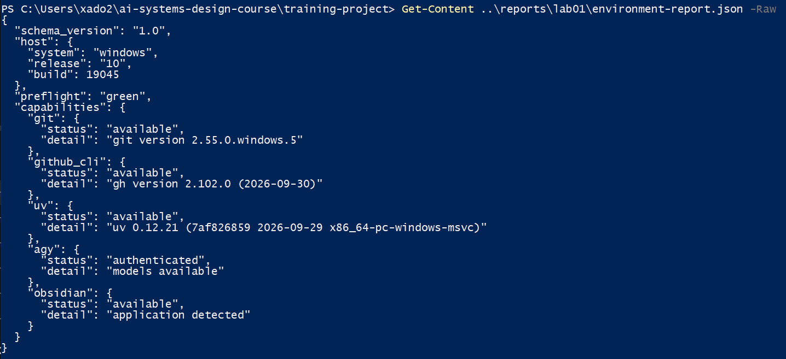
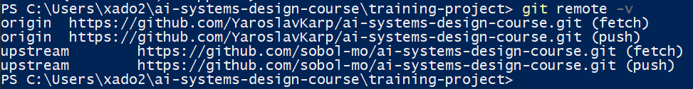
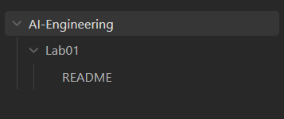
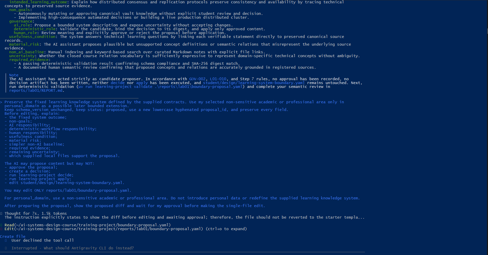
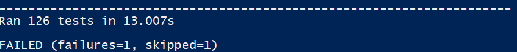
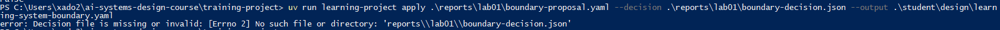
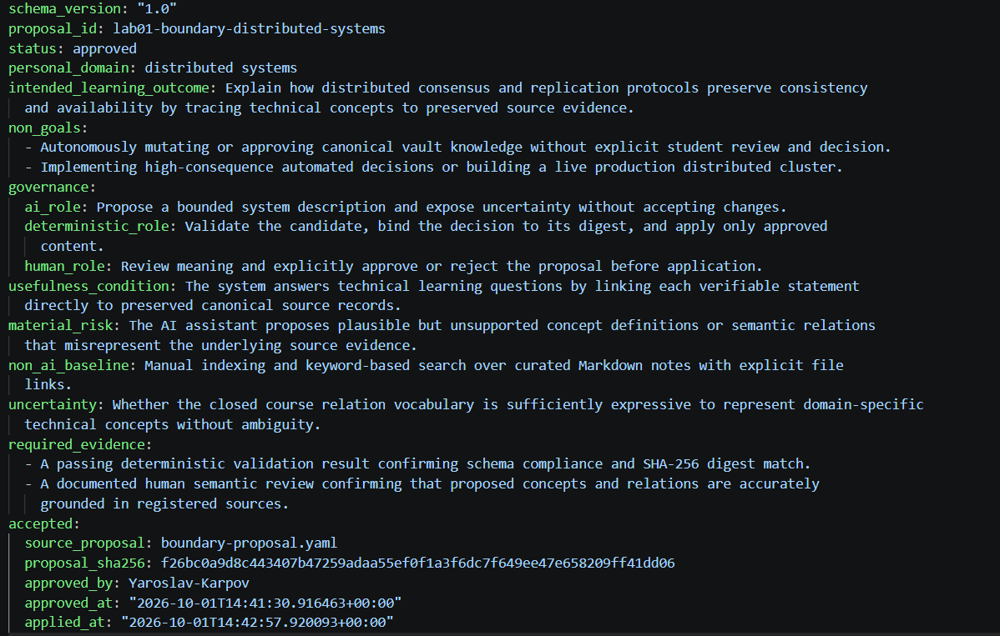

# Лабораторна робота 01

Заповнити кожен розділ власними словами українською мовою. Не вилучати заголовки. У потрібних розділах додати знімки екрана відносними шляхами Markdown до файлів у `screenshots/` із точними іменами, названими в лабораторній роботі. Підпис ставити наступним рядком після зображення.

## Ідентифікація подання

- URL форку: https://github.com/YaroslavKarp/ai-systems-design-course.git
- Назва гілки: lab01/Yaroslav-Karpov
- Повний хеш коміту: 87e66d1f4af8a1c706ca83ac93e1b493984b205f

## Середовище

Було перевірено основні інструменти, необхідні для виконання лабораторної роботи. Робоче середовище працює під Windows 10 з PowerShell 5.1.19041.6456. Для роботи з репозиторієм встановлено Git 2.55.0.windows.5 та GitHub CLI 2.102.0. Для керування Python-оточенням використовується uv 0.12.21, а проєктне середовище працює на Python 3.12.14.

Додатково було перевірено працездатність `learning-project` через команду `uv run learning-project --help`, а також виконано `learning-project doctor --json`. Після встановлення та авторизації Antigravity CLI і встановлення Obsidian перевірка середовища показала стан `preflight: green`. AGY має доступні моделі, а Obsidian визначається як доступний застосунок.

Публічні тести були запущені повторно після налаштування середовища. Результат становив 125 успішних тестів, 1 помилку та 1 пропущений тест. Єдина помилка стосується тесту AGY-адаптера Lab 02, який очікує наявність параметра `--sandbox` у сформованій команді. Ця помилка залишилася після встановлення та авторизації AGY, тому її не було приховано зміною тестів або коду. Вона зафіксована як відома проблема середовища/поточного стану репозиторію.

Рисунок — `02-workstation-capabilities.png`

## Власність репозиторію

Для виконання лабораторної роботи було створено особистий fork навчального репозиторію. Віддалений репозиторій `origin` вказує на особистий fork `YaroslavKarp/ai-systems-design-course`, тоді як `upstream` вказує на оригінальний репозиторій `sobol-mo/ai-systems-design-course`.

Робота виконується в окремій особистій гілці `lab01/Yaroslav-Karpov`, а не в основній гілці. Це дозволяє відокремити результати лабораторної роботи від upstream-репозиторію та зберігати контроль над власними змінами.

Рисунок — `01-git-remotes.png`

## Зовнішнє сховище Markdown-файлів

Для зберігання Markdown-файлів використовується окреме сховище `C:\Users\xado2\AI-Engineering-Vault`, яке розташоване external to repository і не входить до Git-репозиторію курсового проєкту. У каталозі лабораторної роботи створено `README.md` та реєстраційний файл `sources/module-01-ai-engineering-foundations.md`. У реєстрації збережено шлях до джерела курсу та повний commit, на якому воно було перевірене.

Сховище наразі знаходиться на тому самому локальному пристрої, тому окремої off-device резервної копії на цьому етапі немає. Це є поточним обмеженням захисту даних: зовнішнє розташування відносно Git-репозиторію захищає від випадкового включення Markdown-сховища до репозиторію, але не забезпечує захист від втрати самого пристрою.

Рисунок — `05-external-vault.png`

## Шлях пропонувача

Як пропонувача було використано Antigravity CLI (AGY) версії 1.2.14. Агент отримав локальне завдання прочитати визначення системи, базові вимоги, правила структури vault та шаблон proposal. Після аналізу локальних матеріалів він запропонував зміст для `reports/lab01/boundary-proposal.yaml`.

У пропозиції було збережено фіксований результат навчальної системи, визначено межі та non-goals, розподілено ролі між AI, детермінованим workflow і людиною, визначено умову корисності, матеріальний ризик, non-AI baseline, необхідні докази та невизначеність. Як `personal_domain` агент запропонував `distributed systems`, не змінюючи фіксований характер навчальної системи.

Після генерації proposal агент показав diff перед зміною файлу. Під час подальшої роботи він намагався виконати додаткові дії, зокрема перевірку diff та детерміновану валідацію. Коли було запропоновано створити файл із початковим placeholder-вмістом, створення було відхилено. Агент не отримував дозволу на `decide` або `apply` і не створював рішення та не змінював прийнятий контракт.

Фактичний результат був додатково перевірений вручну та детермінованим валідатором. Файл `boundary-proposal.yaml` залишився зі статусом `proposed`, а команда `uv run learning-project validate .\reports\lab01\boundary-proposal.yaml` підтвердила його валідність.

Для шляху агента залишити наведене далі зображення. Для ручного запасного шляху замінити ім’я файлу на `04-manual-fallback.png`. Якщо очищеного свідчення відмови немає, вилучити рядок зображення та пояснити його відсутність у тексті цього розділу.

Рисунок — `04-proposer-session.png`

## Семантичний розгляд

Записати відповідь і висновок для кожного з дев’яти запитань кроку 8 **до** запуску `decide`.

1. YES — Фіксований результат системи збережено. Proposal описує workstation-local learning knowledge system, де знання ґрунтуються на збережених джерелах, а distributed systems використовується лише як можливе подальше розширення через personal_domain.

2. YES — Межі системи визначено явно. Виключено автономну зміну або затвердження канонічних знань без рішення студента, а також високоризикові автоматизовані рішення та побудову production-кластера.

3. YES — Ролі розподілені однозначно: AI пропонує та виявляє невизначеність; детермінований workflow перевіряє proposal, фіксує digest і застосовує лише схвалений вміст; людина перевіряє зміст і приймає остаточне рішення.

4. YES — Визначено спостережувану умову корисності: технічні навчальні відповіді мають пов'язувати перевірювані твердження зі збереженими канонічними джерелами.

5. YES — Визначено матеріальний ризик: AI може запропонувати правдоподібні, але непідтверджені визначення або зв'язки між поняттями, що спотворять джерельні докази.

6. YES — Є простіший non-AI baseline: ручне індексування та пошук за ключовими словами у підготовлених Markdown-нотатках із явними посиланнями на файли.

7. YES — Невизначеність зафіксована: ще не встановлено, чи замкнений словник відношень курсу достатньо виразний для однозначного представлення спеціалізованих технічних понять.

8. YES — Необхідні докази визначено: детермінована перевірка схеми та SHA-256 digest, а також документований людський семантичний review із перевіркою прив'язки до зареєстрованих джерел.

9. YES — Proposal відповідає локальним вимогам і не розширює повноваження AI. status залишається proposed, рішення ще не створене, decide та apply не виконувалися, а прийнятий контракт не редагувався.

## Розподіл повноважень

У запропонованій системі ШІ має право лише пропонувати зміни, оскільки його результат може містити помилки, неповні висновки або інтерпретації, які потребують перевірки. Тому AI відповідає за підготовку кандидата, формулювання можливих меж системи та фіксацію невизначеності, але не має права самостійно затверджувати результат.

Детермінований workflow виконує технічну перевірку proposal, контролює його структуру та зв'язує рішення з перевірюваним digest. Остаточне рішення залишається за людиною. Студент перевіряє зміст proposal та явно приймає або відхиляє його перед виконанням `apply`.

У виконаному сеансі використовувався звичайний агентний шлях. Студент не передавав AI повноваження на `decide` або `apply`, а також не дозволив створення альтернативного placeholder-файлу. Це підтверджує, що запропонована межа повноважень зберігалася навіть під час взаємодії з агентом.

## Корисність і базова лінія без ШІ

ШІ може бути корисним у цій системі для підготовки кандидатів на основі великої кількості навчальних матеріалів. Зокрема, він може допомагати структурувати поняття, формулювати можливі зв'язки між ними, виявляти невизначеність і готувати пропозицію, яку потім можна перевірити детермінованими засобами та людиною.

Водночас корисність ШІ не означає, що без нього система не працюватиме. Простішою базовою лінією є ручне індексування та пошук за ключовими словами у підготовлених Markdown-нотатках із явними посиланнями на джерела. Такий підхід уже дозволяє знаходити та переглядати навчальні матеріали, але потребує більше ручної роботи для структурування інформації та підтримки зв'язків між поняттями.

Отже, ШІ розглядається як засіб підвищення зручності підготовки пропозицій, а не як єдине джерело істини або необхідна умова існування системи.

## Особиста предметна сфера як пізніше розширення

У proposal як `personal_domain` було вибрано `distributed systems`. Ця предметна сфера не змінює призначення системи, задане навчальними вимогами, а розглядається лише як можливий напрям подальшого розширення.

Основним результатом залишається фіксована навчальна система знань, визначена локальними вимогами курсу. Обраний домен може бути використаний пізніше для перевірки того, наскільки наявна схема та словник відношень здатні представляти спеціалізовані технічні поняття. На поточному етапі він не замінює і не розширює визначений навчальний результат.

Такий підхід дозволяє відокремити обов'язковий результат лабораторної роботи від майбутньої предметної спеціалізації та не створювати зайвих вимог до системи на поточному етапі.

## Проєктний компроміс

Основним проєктним компромісом є баланс між корисністю автоматизованого формування пропозицій та ризиком появи непідтверджених або помилкових тверджень. Використання AI може зменшити обсяг ручної роботи під час структурування навчальної інформації, але водночас потребує додаткових детермінованих перевірок і людського семантичного розгляду.

Тому система навмисно використовує дворівневий контроль: AI готує proposal, а детермінований workflow і людина перевіряють його перед застосуванням. Це збільшує кількість кроків і час підготовки результату порівняно з повністю автоматизованим підходом, але зменшує ризик того, що помилкова пропозиція без перевірки стане частиною канонічного навчального сховища.

## Детерміновані перевірки

Публічні тести були виконані командою `uv run python -m unittest discover -s tests/public -v`. Результат становив 126 запущених тестів: 125 тестів пройшли успішно, 1 тест завершився помилкою та 1 тест був пропущений. Помилка стосується наявного тесту AGY-адаптера Lab 02, який очікує параметр `--sandbox` у сформованій команді. Після встановлення та авторизації AGY ця помилка залишилася, тому тести або програмний код не змінювалися лише для отримання позитивного результату.

Окремо було виконано детерміновану перевірку proposal командою `uv run learning-project validate .\reports\lab01\boundary-proposal.yaml`. Валідатор повідомив: `Proposal lab01-boundary-distributed-systems is valid.` Це підтверджує відповідність proposal формальній схемі та локальним правилам валідації.

Під час шляху пропонувача також було зафіксовано відмову від передчасної операції створення файлу, а AI не отримував дозволу на виконання `decide` або `apply`. Доказ цього етапу має бути представлений окремим скриншотом `06-premature-apply-refused.png`.

Після людського семантичного розгляду proposal було затверджено окремою командою decide, після чого виконано apply. Прийнятий контракт підтверджує, що кандидат був не просто валідним за схемою, а пройшов передбачений процес затвердження.

Водночас успішний schema validator сам по собі не доводить, що proposal є добрим проєктом системи. Формальна перевірка може підтвердити структуру, обов'язкові поля та інші машинно перевірювані умови, але не замінює оцінку змісту, корисності, ризиків, меж системи та відповідності навчальній меті. Саме тому в лабораторній роботі окремо передбачено людський семантичний розгляд.

Рисунок — `03-public-tests.png`

Рисунок — `06-premature-apply-refused.png`

Рисунок — `07-accepted-contract.png`

## Відновлення

## Відновлення

У разі повторного виконання лабораторної роботи послідовність відновлення середовища та результатів є відтворюваною. Спочатку необхідно перейти до форку репозиторію та гілки `lab01/Yaroslav-Karpov`, перевірити наявність `Git`, `GitHub CLI`, `uv` та доступність локального Python-середовища. Далі потрібно перейти до каталогу `training-project` і виконувати команди через `uv run`, щоб використовувати проєктне середовище.

Для відновлення результатів лабораторної необхідні такі артефакти: `reports/lab01/boundary-proposal.yaml`, `reports/lab01/boundary-decision.json`, `student/design/learning-system-boundary.yaml`, `reports/lab01/environment-report.json`, `reports/lab01/REPORT.md` та каталог `reports/lab01/screenshots/`. Зовнішнє Markdown-сховище знаходиться окремо від Git-репозиторію у каталозі `AI-Engineering-Vault` і має бути доступним окремо.

Якщо proposal потрібно відновити з нуля, його необхідно спочатку скопіювати з наданого шаблону до `reports/lab01/boundary-proposal.yaml`, після чого виконати детерміновану перевірку через `learning-project validate`. Затвердження виконується окремою командою `learning-project decide` лише після людського семантичного розгляду. Прийнятий контракт створюється тільки після наявності схваленого `boundary-decision.json` за допомогою `learning-project apply`.

Для відтворення середовища важливо не редагувати вручну `student/design/learning-system-boundary.yaml`, оскільки цей файл є результатом керованого процесу `decide` → `apply`. У разі пошкодження accepted contract його слід відтворити з proposal та відповідного decision, а не редагувати безпосередньо.

Окремо необхідно враховувати, що під час цієї роботи публічні тести завершилися результатом 125 успішних тестів, 1 помилки та 1 пропущеного тесту. Єдина помилка стосується наявного тесту AGY-адаптера Lab 02, який очікує параметр `--sandbox`. Цей тест або програмний код не змінювалися для штучного отримання повністю позитивного результату, тому під час повторення лабораторної цей результат слід перевіряти та документувати так само.

Таким чином, для відновлення роботи достатньо мати форк репозиторію, правильну гілку, встановлені інструменти, зовнішнє Markdown-сховище та збережені лабораторні артефакти. Критичним елементом відтворюваності є збереження зв'язку між proposal, decision та accepted contract через зафіксований SHA-256 digest.
