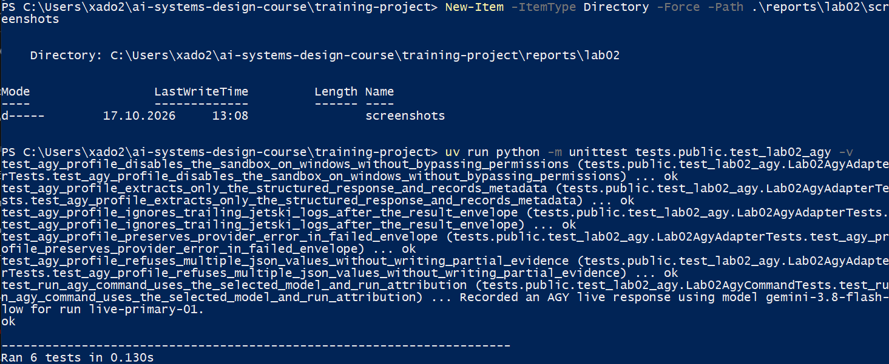
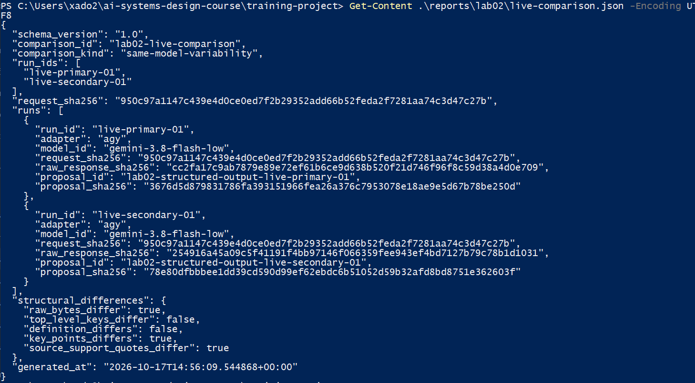
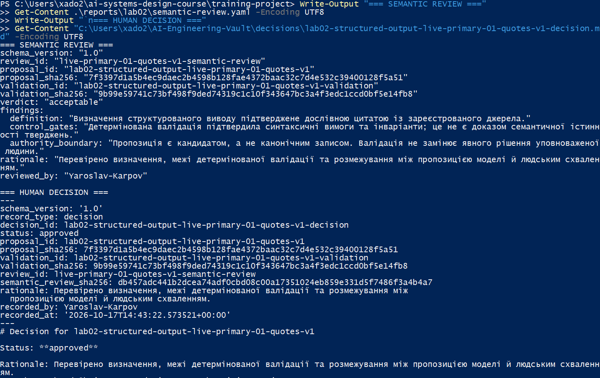
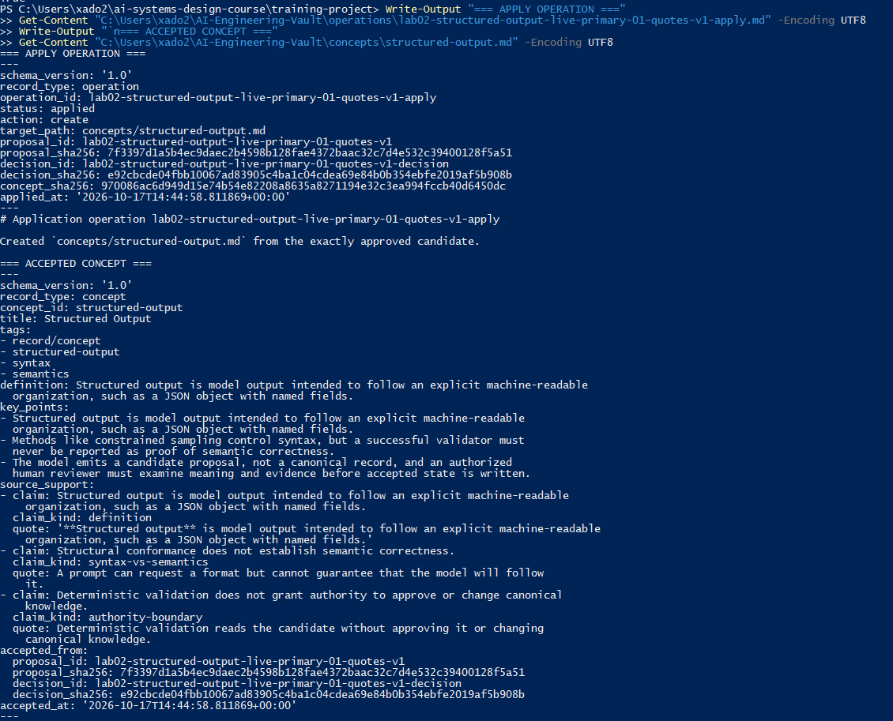
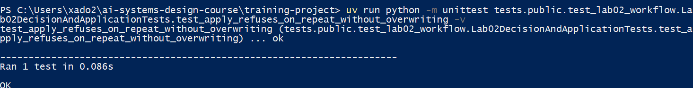
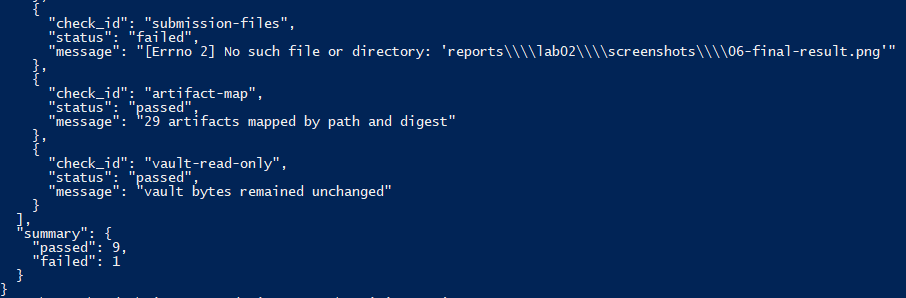

# Лабораторна робота 02

## Ідентифікація подання

- URL форку: https://github.com/YaroslavKarp/ai-systems-design-course.git
- Назва особистої гілки: `lab02/Yaroslav-Karpov`
- Повний хеш коміту зі свідченнями: `728da6004ab7e1d20e0421cd7c90bd4098212042`

## Мета роботи

Розробити контрольований процес перетворення відповіді великої мовної моделі на прийняте знання в зовнішньому сховищі. Процес має розділяти формальну перевірку структури, семантичний розгляд і людське схвалення; зберігати зв'язки між джерелом, запитом, відповіддю, пропозицією, перевіркою, рішенням та операцією; не допускати автоматичного перезапису прийнятого знання без належного дозволу.

## Початковий стан і реєстрація джерела

Роботу виконано у форку курсового репозиторію `ai-systems-design-course`, в особистій гілці `lab02/Yaroslav-Karpov`. Зареєстроване джерело теорії розміщене у зовнішньому сховищі за шляхом `sources/module-02-foundation-models-and-ai-application-architecture.md`.

Для фрагмента `module-02-1-3-structured-output-controls-v1` зафіксовано SHA-256 `7d7d5ce2d33d4852985c2337292fbf257ae554cefbbf7e4b9e4ef8090a797063`. Це дає змогу ідентифікувати конкретний вміст джерела, на який спирається пропозиція.

`course_commit` дорівнює `728da6004ab7e1d20e0421cd7c90bd4098212042`. Він позначає базовий стан курсового коду, потрібний для відтворення та перевірки лабораторної, а не окремий коміт подання звітних матеріалів.

## Детерміновані шлюзи

Перевірено три тестові фікстури.

- `valid-response.json` пройшла детерміновані перевірки: структура відповіді відповідає очікуваному формату та інваріантам.
- `malformed-response.txt` відхилено на синтаксичному шлюзі. Некоректний формат не повинен породжувати пропозицію для подальшого прийняття.
- `semantic-unsupported-response.json` пройшла структурні перевірки, але потребує семантичного розгляду. Формально коректна відповідь може містити непідтверджені або неправильні твердження.

Отже, синтаксична перевірка та перевірка інваріантів визначають відповідність формальним обмеженням, але не доводять семантичної істинності. Остаточне рішення не може бути делеговане лише валідатору.

Рисунок — `01-offline-gates.png`

## Живі запуски та порівняння

Виконано два живі запуски через адаптер `agy` з моделлю `gemini-3.8-flash-low`: `live-primary-01` і `live-secondary-01`. Обидва запуски використовували однаковий запит із SHA-256 `950c97a1147c439e4d0ce0ed7f2b29352feda2f7281aa74c3d47c27b` (ідентифікатор дайджесту запиту зафіксований у метаданих запусків).

Порівняння має тип `same-model-variability`, оскільки метадані підтверджують однакові адаптер і модель для обох запусків. Сирі відповіді різні: SHA-256 першої відповіді — `cc2fa17c9ab7879e89e72ef61b6ce9d638b520f21d746f96f8c59d38a4d0e709`, другої — `254916a45a09c5f41191f4bb97146f066359fee943ef4bd7127b79c78b1d1031`.

У відповідях збіглися ключі верхнього рівня та визначення, але відрізнялися `key_points` і `source_support_quotes`. Це демонструє мінливість результатів навіть за однакових моделі й запиту. Саме порівняння не встановлює причину цих відмінностей.

Рисунок — `03-live-comparison.png`

## Семантична коректність і повноваження

Успішний `validate` підтверджує відповідність кандидата очікуваній структурі та перевіреним інваріантам. Навіть схема на стороні постачальника гарантує лише обмеження формату, а не істинність тверджень, точність цитат або достатність доказів.

Модель формує пропозицію, але не має повноважень самостійно записувати її як канонічне знання. Детермінований код перевіряє правила й виконує лише дозволені операції. Людина перевіряє зміст і приймає рішення. Операція застосування пов'язує конкретні схвалені артефакти та записує прийнятий стан лише після проходження необхідних перевірок.

## Семантичний розгляд і рішення

Для кандидата `lab02-structured-output-live-primary-01-quotes-v1` виконано семантичний розгляд із вердиктом `acceptable`. Розглянуто точність визначення, межі детермінованої валідації та розмежування між пропозицією моделі й канонічним записом.

У розгляді зафіксовано, що визначення підтверджується дослівною цитатою із зареєстрованого джерела, а успішна структурна перевірка не є доказом семантичної істинності. Людське рішення `approved` записано користувачем `Yaroslav-Karpov`. Рішення посилається на конкретні ідентифікатори та SHA-256 пропозиції, результату перевірки й семантичного розгляду.

Рисунок — `04-review-decision.png`

## Прив’язки SHA-256

У процесі використано дайджести для контролю цілісності та зв'язування артефактів:

- Джерело і фрагмент: SHA-256 фрагмента `7d7d5ce2d33d4852985c2337292fbf257ae554cefbbf7e4b9e4ef8090a797063`.
- Запит і відповіді: один і той самий запит має SHA-256 `950c97a1147c439e4d0ce0ed7f2b29352feda2f7281aa74c3d47c27b`; відповіді двох запусків мають різні дайджести.
- Пропозиція і перевірка: SHA-256 обраної пропозиції — `7f3397d1a5b4ec9daec2b4598b128fae4372baac32c7d4e532c39400128f5a51`; SHA-256 результату її перевірки — `9b99e59741c73bf498f9ded74319c1c10f343647bc3a4f3edc1ccd0bf5e14fb8`.
- Розгляд і рішення: рішення посилається на семантичний розгляд із SHA-256 `db457adc441b2dcea74adf0cbd08c00a17351024eb859e331d5f7486f3a4b4a7` та зберігає посилання на перевірений кандидат.
- Рішення і прийняте поняття: SHA-256 рішення — `e92cbcde04fbb10067ad83905c4ba1c04cdea69e84b0b354ebfe2019af5b908b`; SHA-256 прийнятого поняття — `970086ac6d949d15e74b54e82208a8635a8271194e32c3ea994fccb40d6450dc`.

Дайджести допомагають виявляти зміни в артефактах і перевіряти відповідність записаного ланцюга. Вони самі по собі не доводять авторства зовнішньої моделі, незалежності постачальника або семантичної правильності змісту.

## Контрольоване застосування

Після успішної перевірки кандидата, семантичного розгляду та явного людського рішення виконано операцію `lab02-structured-output-live-primary-01-quotes-v1-apply` зі статусом `applied` і дією `create`.

Створено канонічний файл `concepts/structured-output.md`. Журнал операції містить ідентифікатори та дайджести пропозиції й рішення, а також SHA-256 створеного поняття `970086ac6d949d15e74b54e82208a8635a8271194e32c3ea994fccb40d6450dc`. Це пов'язує прийнятий стан із конкретними перевіреними артефактами.

Рисунок — `05-controlled-apply.png`

## Відмова без зміни прийнятого стану

Повторне застосування перевірено окремим автоматизованим тестом `test_apply_refuses_on_repeat_without_overwriting`. Тест проходить у тимчасовому ізольованому сховищі: після першого застосування повторна операція відхиляється, а байти вже створеного поняття залишаються незмінними.

Цей результат підтверджує поведінку механізму захисту від перезапису в ізольованому тестовому сценарії. Повторне застосування до основного зовнішнього сховища окремо не виконувалося. Тому кількість успішних записів операції та дайджести поняття до і після відмови для основного сховища тут не заявляються.

Рисунок — `02-refusal-unchanged.png`

## Проєктний компроміс

Використання легкої моделі та повторних живих запусків дає змогу досліджувати мінливість відповідей, але результати не є повністю відтворюваними. Детерміновані шлюзи відсіюють некоректні структури, проте не замінюють перевірки змісту. Людський розгляд підвищує контроль якості, водночас збільшуючи час роботи. Для цієї лабораторної обрано компроміс на користь простежуваності, перевірюваності та контролю прийняття знання, а не повної автоматизації.

## Захист облікових і платіжних даних

Для живих запусків використовувався адаптер `agy`. У звіт включено ідентифікатори запусків, модель, результати та дайджести артефактів, але не секрети автентифікації. Облікові дані й платіжні реквізити не включалися до аргументів команд, файлів Git або цього звіту. OpenRouter у описаних живих запусках не використовувався, тому питання перевірки платіжної картки постачальником OpenRouter до цих запусків не застосовується.

## Канонічний, аудиторський і похідний стан

Канонічне прийняте знання зберігається у `C:\Users\xado2\AI-Engineering-Vault\concepts\structured-output.md`.

Окремо від нього зберігаються джерело, сирі відповіді запусків, метадані, пропозиції, результати валідації, семантичний розгляд, людське рішення та журнал операції. Ці артефакти дають змогу простежити шлях від джерела до прийнятого поняття. Порівняння й звітні результати є похідними матеріалами, які можна відтворити за умови збереження відповідних вхідних артефактів та інструментів.

## Остаточна перевірка

Команда `uv run learning-project lab02 verify --vault "C:\Users\xado2\AI-Engineering-Vault" --report-dir .\reports\lab02` завершилася повідомленням `Laboratory 02 verification passed.` Під час перевірки пройшли контроль джерела, базового коміту курсу, тестових фікстур, порівняння живих запусків, обраного кандидата, прийнятого стану, ізоляції постачальника, звітних файлів, карти артефактів і незмінності зовнішнього сховища.

Прийняте поняття також відкрито в Obsidian: видно визначення, ключові положення, джерельні цитати та `accepted_from`. Перевірка підтверджує узгодженість визначених артефактів і правил процесу на момент запуску. Вона не доводить абсолютної істинності кожного твердження, авторства відповіді моделі або відсутності всіх можливих помилок.

Рисунок — `06-final-result.png`

## Висновки

Мету роботи досягнуто частково. Реалізовано та перевірено контрольований шлях від зареєстрованого джерела й живих відповідей моделі до структурно перевіреної пропозиції, людського схвалення та канонічного поняття. Збережено зв'язки між основними артефактами, порівняно два запуски однієї моделі й успішно пройдено автоматичну верифікацію лабораторної.

Водночас повторна відмова від перезапису була продемонстрована ізольованим автоматизованим тестом, а не окремою операцією в основному сховищі. Також остаточний звіт потребує перевірки на відповідність вимогам оформлення та наявним скриншотам перед поданням.
