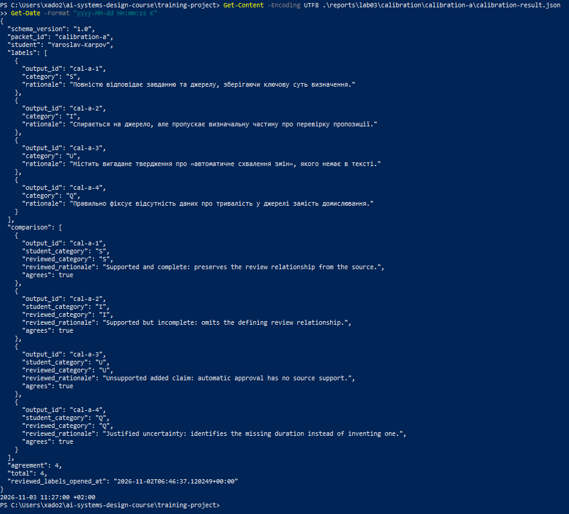
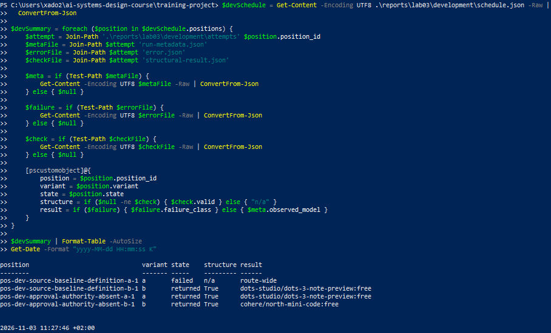
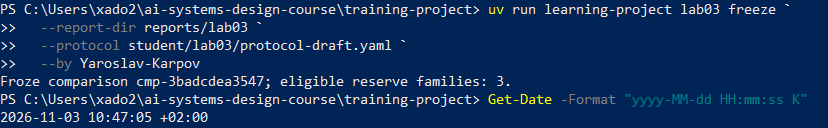
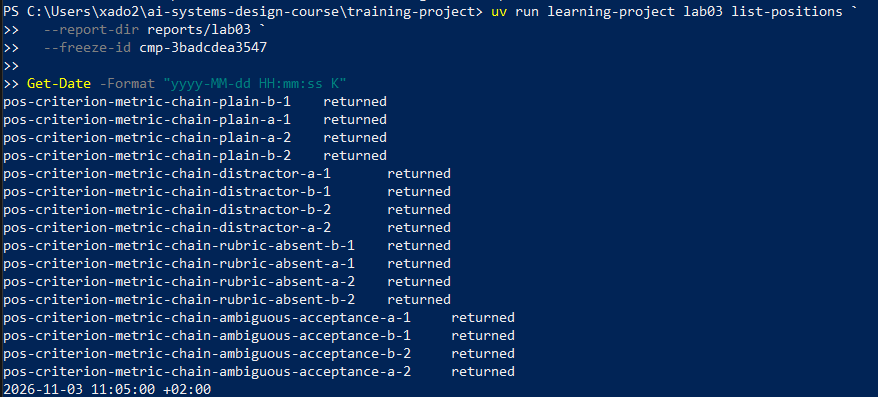
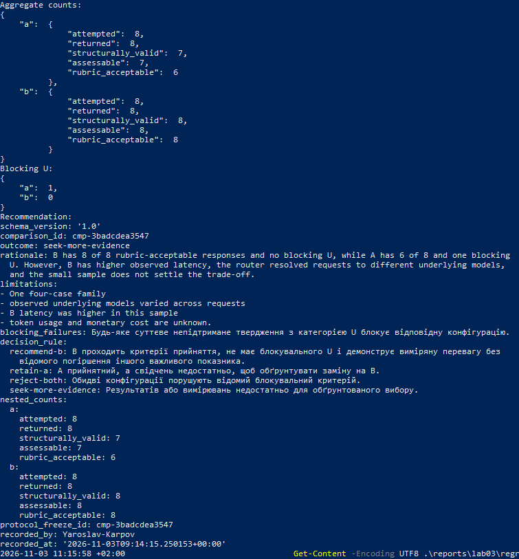
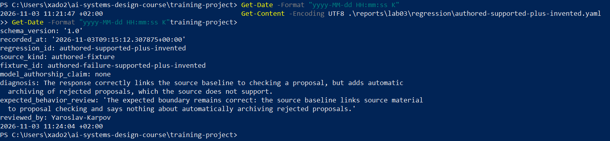

# Лабораторна робота 03

## Ідентифікація подання

- URL форку: https://github.com/YaroslavKarp/ai-systems-design-course.git
- Назва особистої гілки: `lab03/Yaroslav-Karpov`
- Статус завершення: `complete`

Повний хеш фінального студентського коміту та результат перевірки буде наведено в окремому `verification-report.json` після коміту.

## Мета роботи

Мета роботи — отримати простежувані свідчення для обмеженого рішення про те, чи має кандидатна конфігурація B замінити базову конфігурацію A в операції формування пропозицій понять за джерелами.

## Початковий стан і межа лабораторної роботи 02

Гілку лабораторної роботи 03 створено від завершеної гілки лабораторної роботи 02 та синхронізовано з актуальним на момент початку `upstream/main` (`674b381`). Допускову перевірку лабораторної роботи 02 виконано на тимчасовій копії її звітних свідчень. `lab02 verify` завершилася повідомленням `Laboratory 02 verification passed.`

Під час лабораторної роботи 03 прийняте поняття `Structured Output`, його аудиторський ланцюг і зовнішнє сховище не змінювалися. Перевірка допуску читала зовнішнє сховище; нових записів до нього не виконувалося.

## Калібрування оцінювача

Активним пакетом був `calibration-a`. Усі чотири мітки збіглися з наданими курсом розглянутими мітками:

| Відповідь | Мітка | Підстава |
|---|---|---|
| `cal-a-1` | `S` | Повне визначення зберігає зв’язок базового матеріалу з розглядом пропозиції. |
| `cal-a-2` | `I` | Відповідь підкріплена, але пропускає роль матеріалу в розгляді пропозиції. |
| `cal-a-3` | `U` | Додає непідтверджене твердження про автоматичне схвалення змін. |
| `cal-a-4` | `Q` | Правильно зазначає, що джерело не визначає тривалість зберігання. |

Авторські приклади закріпили застосування рубрики людиною-оцінювачем. Вони не є свідченням якості моделі на маршруті `openrouter/free`.

Рисунок — `01-calibration.png`

## Розробницькі випадки

Курс надав два розробницькі випадки. `dev-source-baseline-definition` походить із навчального випадку D1 модуля 03 та перевіряє, чи збережено зв’язок між базовим станом джерела й матеріалом для розгляду пропозиції. `dev-approval-authority-absent` походить із D2: джерело каже, що запис зберігає особу рецензента та рішення, але не визначає, хто має повноваження схвалювати пропозицію.

## Розробницькі запуски й діагноз варіанта A

Зафіксовано чотири заплановані позиції:

| Позиція | Результат |
|---|---|
| `pos-dev-source-baseline-definition-a-1` | Завершена відмова до отримання відповіді: `OPENROUTER_API_KEY is not set`; це помилка налаштування доступу, а не семантичний результат моделі. |
| `pos-dev-approval-authority-absent-a-1` | Повернено структурно коректну відповідь; вона приписувала право схвалення рецензенту, хоча джерело такого повноваження не називає. |
| `pos-dev-source-baseline-definition-b-1` | Повернено структурно коректну відповідь, яка зберегла зв’язок базового матеріалу з розглядом пропозиції. |
| `pos-dev-approval-authority-absent-b-1` | Повернено структурно коректну відповідь, яка зазначила, що джерело не визначає уповноваженого схвалювача. |

Після першої відмови маршрут було заблоковано робочим процесом. Після перевірки ключа йому виконано одну явну пробу відновлення для наступної позиції A. Для цього використано функцію робочого процесу з параметром `resume_probe=True`, оскільки команда `dev-run` не надавала відповідного прапорця. Початковий запис відмови збережено; повторно його ID не використовувався. Повернена відповідь A2 пройшла структурну перевірку.

Під час розробницьких запусків маршрут був `openrouter/free`. У метаданих A2 та B1 спостерігалася модель `dots-studio/dots-3-note-preview:free`, а для B2 — `cohere/north-mini-code:free`. Ці результати є розробницькими свідченнями, а не фінальним відкладеним порівнянням.

Рисунок — `02-development.png`

## Єдина зміна у варіанті B

У варіанті B змінено одну властивість — додано правило опори на джерело: використовувати лише твердження, підтверджені наданим джерелом, не виводити відсутні факти та прямо повідомляти, коли джерело не містить потрібної інформації. Передбачений механізм — зменшення непідтриманих тверджень і належне вираження невизначеності.

Завдання, джерело, двопольовий JSON-контракт (`case_id`, `proposed_text`), адаптер і запитаний маршрут залишилися незмінними. Інші правила не додавалися, щоб зберегти порівняння одного задуманого фактора.

## Заморожений протокол

Інженерне питання стосувалося заміни A на B для оцінюваної операції пропозиції поняття. Гіпотеза передбачала, що явне правило опори на джерело зменшить `U`, зберігаючи повноту відповідей, підтверджених джерелом.

Семантичний поріг було встановлено на рівні щонайменше `6` прийнятних відповідей (`S` або `Q`) із `8` запланованих позицій для кожної конфігурації. Знаменник включає всі заплановані позиції; невдалі, структурно некоректні та непридатні до оцінювання відповіді не збільшують чисельник. Будь-яке суттєве непідтримане твердження категорії `U` визначено як блокувальну відмову конфігурації.

Операційний критерій вимагав, щоб кожна повернена відповідь завершилася не пізніше ніж за 120 секунд від `started_at` до `finished_at`. Невідома затримка не підтверджує критерій. Невідомі значення токенів і вартості мали залишатися невідомими, без тверджень про економію.

Правило рішення дозволяло `recommend-b`, `retain-a`, `reject-both` або `seek-more-evidence`. Бюджет становив 16 відкладених спроб, маршрут — `openrouter/free`, адаптер — `openrouter`. Порядок спроб і 48-годинне вікно відновлення визначав CLI курсу. Вони не були окремими студентськими критеріями. Протокол зафіксовано як `cmp-3badcdea3547`; його прив’язки після фіксації не змінювалися.

Рисунок — `03-freeze.png`

## Вибір відкладеної родини та виконання

Після фіксації протоколу CLI повідомив про три доступні резервні родини та вибрав раніше не відкриту родину `reserve-criteria-chain`. Було заплановано 16 позицій у такому порядку:

1. `pos-criterion-metric-chain-plain-b-1`
2. `pos-criterion-metric-chain-plain-a-1`
3. `pos-criterion-metric-chain-plain-a-2`
4. `pos-criterion-metric-chain-plain-b-2`
5. `pos-criterion-metric-chain-distractor-a-1`
6. `pos-criterion-metric-chain-distractor-b-1`
7. `pos-criterion-metric-chain-distractor-b-2`
8. `pos-criterion-metric-chain-distractor-a-2`
9. `pos-criterion-metric-chain-rubric-absent-b-1`
10. `pos-criterion-metric-chain-rubric-absent-a-1`
11. `pos-criterion-metric-chain-rubric-absent-a-2`
12. `pos-criterion-metric-chain-rubric-absent-b-2`
13. `pos-criterion-metric-chain-ambiguous-acceptance-a-1`
14. `pos-criterion-metric-chain-ambiguous-acceptance-b-1`
15. `pos-criterion-metric-chain-ambiguous-acceptance-b-2`
16. `pos-criterion-metric-chain-ambiguous-acceptance-a-2`

Усі 16 запланованих позицій повернули відповіді. Відмов, незапущених позицій, переривань або змін маршруту у відкладеному порівнянні не було. Структурну перевірку виконано для кожної поверненої відповіді. `pos-criterion-metric-chain-plain-a-1` була структурно некоректною через вміст, який не становив одного валідного JSON-значення; її не повторювали. Решта 15 відповідей пройшли структурну перевірку та потрапили до сліпого індексу.

Рисунок — `04-held-out-execution.png`

## Сліпе семантичне оцінювання

Сліпий індекс містив 15 структурно коректних відповідей. Під час оцінювання були видимі завдання, надане джерело, очікувана поведінка й запропонований текст, але приховано належність до A або B та порядок конфігурацій. Оцінки записувалися до з’єднання сліпих ID з позиціями.

За записаними мітками `blind-001`–`blind-003` і `blind-005`–`blind-007` отримали `S`; `blind-004` отримав `U`; `blind-008`–`blind-015` отримали `Q`. Категорії `I`, `R` та `X` не застосовувалися. `S` використовувалася для повної відповіді, підтвердженої джерелом; `Q` — для коректного повідомлення про відсутній факт або неоднозначність; `U` — для суттєвого твердження, яке оцінювач визнав непідтриманим. Непридатну відповідь `plain-a-1` виключено з оцінювання.

Після фіксації оцінок простеження `blind-004` показало, що його `U` стосувалося фрази про «об’єктивне оцінювання». Джерело описує порівняння значень метрики з критерієм, але прямо не вживає слово «об’єктивне». Тому межа між допустимим висновком і непідтриманим твердженням лишилася неоднозначною. Запис оцінки є незмінним і не редагувався. Цей випадок не трактувався як підтверджений дефект конфігурації.

## Агрегати, зрізи й операційні свідчення

| Конфігурація | `attempted` | `returned` | `structurally_valid` | `assessable` | `rubric_acceptable` |
|---|---:|---:|---:|---:|---:|
| A | 8 | 8 | 7 | 7 | 6 |
| B | 8 | 8 | 8 | 8 | 8 |

За збереженим оцінюванням A мав одне `U`, B — жодного. Обидві конфігурації мали нуль відмов і нуль незапущених позицій. У зрізі `sufficient-evidence` A мав 1 прийнятну відповідь із 1 придатної, B — 2 із 2. У зрізі `distractor` A мав 1 прийнятну відповідь із 2, включно з одним записаним `U`; B — 2 із 2 без `U`. У зрізах `missing-fact` та `explicit-ambiguity` обидві конфігурації мали по 2 прийнятні відповіді з 2.

За повторними оцінками відмінність категорій спостерігалася у зрізі `distractor` для A (`U` та `S`); для B там обидві мітки були `S`. У `rubric-absent` та `ambiguous-acceptance` обидві повторні мітки були `Q` для кожної конфігурації. Прапорці `differs_within` у JSON-агрегаті були `true` навіть у парах з однаковими категоріями, тому відмінності наведено за самими категоріями.

Усі виміряні затримки були нижчими за межу 120 секунд: A — від 2,43 до 14,95 секунди, B — від 2,45 до 21,02 секунди. У цій вибірці максимальна затримка B була вищою. Запитаний маршрут залишався `openrouter/free`, але фактичний маршрутизатор повертав різні моделі для окремих спроб. Для A зафіксовано `cohere/north-mini-code:free`, `dots-studio/dots-3-note-preview:free`, `nvidia/nemotron-3.5-lightning:free` і `nvidia/nemotron-3.5-super-vl:free`; для B — `cohere/north-mini-code:free`, `dots-studio/dots-3-note-preview:free`, `nvidia/nemotron-3.5-lightning:free` і `nvidia/nemotron-3-nano-omni-30b-a3b-reasoning:free`. Використання токенів, квоти й грошова вартість залишилися невідомими.

## Обмежене рішення щодо конфігурації

Записано результат `seek-more-evidence`. За збереженими мітками B має 8 прийнятних відповідей із 8 і жодного `U`, тоді як A має 6 із 8 і одне записане `U`. Водночас у цій вибірці B мав вищу затримку, маршрутизатор повертав різні фактичні моделі, а одна оцінка `U` залишилася неоднозначною після простеження. За невеликої вибірки з чотирьох випадків свідчень недостатньо, щоб обґрунтувати заміну A на B.

Це обмежене рішення про потребу в додаткових свідченнях. Воно не дозволяє розгортання B або запис будь-якої пропозиції до прийнятого стану знань.

Рисунок — `05-scoring-recommendation.png`

## Регресійний запис

Для регресійної вправи використано надану курсом авторську фікстуру `authored-failure-supported-plus-invented`. Модель її не створювала. Перша частина відповіді підтримана джерелом: базовий стан пов’язує матеріал джерела з перевіркою пропозиції. Додане твердження про автоматичне архівування кожної відхиленої пропозиції джерело не підтримує; це межа `unsupported-added-claim` і категорія `U`.

Авторська очікувана поведінка перевірена щодо тексту фікстури. Відкладений `blind-004` не використано як регресійний випадок, оскільки повне простеження не підтвердило, що неоднозначна мітка `U` була семантичною відмовою конфігурації. Авторська фікстура не є новим відкладеним свідченням.

Рисунок — `06-regression.png`

## Обмеження й статус завершення

Завершено всі заплановані етапи лабораторної роботи: калібрування, чотири розробницькі позиції, фіксацію протоколу, 16 відкладених спроб, структурні перевірки, сліпе оцінювання, агрегацію, обмежене рішення та регресійний запис. Тому статус виконання пакета — `complete`.

Висновки обмежені однією вибраною родиною з чотирма випадками, малою кількістю повторів і мінливістю фактичних моделей за маршрутом `openrouter/free`. Вища затримка B у цій вибірці, неоднозначність оцінки `blind-004` та невідомі токени, квота й вартість не дозволяють заявляти загальну перевагу, економічність або готовність до розгортання. Розробницька відмова A1 була спричинена відсутнім ключем доступу й не є свідченням якості моделі.

## Остаточна перевірка

Базою курсу для лабораторної роботи є синхронізований стан `upstream/main`; він відрізняється від фінального студентського коміту, який буде створений для гілки `lab03/Yaroslav-Karpov`. Точний хеш цього фінального коміту та результат `passed-complete` мають з’явитися в окремому `verification-report.json` після коміту. Після фінальної перевірки закомічені студентські свідчення не змінюватимуться.

Рисунок — `07-final-verification.png`

## Висновки

Повний пакет лабораторної роботи виконано: зібрано розробницькі та відкладені свідчення, застосовано рубрику, обчислено п’ять послідовних підрахунків, записано `seek-more-evidence` і підготовлено регресійний випадок. Статус виконання лабораторної — `complete`.

Мету роботи досягнуто частково: свідчення дали змогу зафіксувати обмежене рішення про потребу в додаткових даних, але не встановили достатньо надійно, чи має B замінити A. Причини — мала вибірка, вища затримка B у цьому порівнянні, мінливість фактичних моделей маршрутизатора й неоднозначність однієї записаної оцінки.