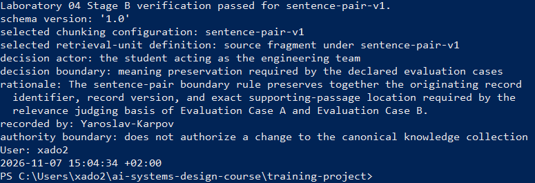
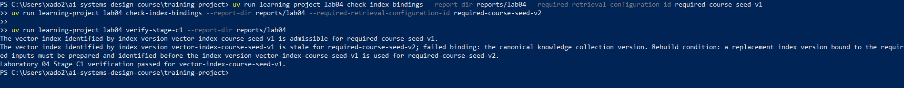
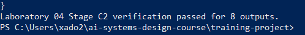
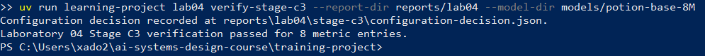

# Лабораторна робота 04

## Ідентифікація

- Прізвище та ім’я студента: Ярослав Карпов
- Ідентифікатор студента: Yaroslav-Karpov
- URL форка: https://github.com/YaroslavKarp/ai-systems-design-course
- Особиста гілка: `lab04/Yaroslav-Karpov`
- Статус завершення: `complete`

## Мета роботи

Мета — отримати свідчення для обмеженого інженерного рішення про те, чи має пошук на основі ембедингів замінити лексичний пошук для оголошеної операції над канонічною колекцією знань `course-seed-v1`.

## Хід виконання

### Вибір межі одиниці інформаційного пошуку

До записів `R-A` і `R-B` було застосовано правила `sentence-pair-v1` та `fixed-72-v1`. Перше створило одиниці `F-A` і `F-B`; друге — `F-A-72-1`–`F-A-72-4` і `F-B-72-1`–`F-B-72-2`. Фрагмент `F-A` походить із `R-A` та джерела `course-source-a`, обидва версії 1, діапазон символів 1–215. `F-B` походить із `R-B` і `course-source-b`, обидва версії 1, діапазон 1–143. Фрагменти з правилом 72 символи зберігають власні ідентифікатори записів, джерел і діапазони символів.

Усі фрагменти позначені як похідні артефакти пошуку, а не члени канонічної колекції. Було обрано `sentence-pair-v1`: `F-A` зберігає разом ідентифікатор первинного запису, його версію та точне місце підтвердного уривка, потрібні підставою для судження про релевантність. Окремий фрагмент правила `fixed-72-v1` не зберігає всіх трьох елементів без об’єднання з іншими фрагментами. Перевірка `verify-stage-b` пройшла. Опис узгоджується з `stage-b/boundary-comparison.json` і `stage-b/boundary-decision.yaml`.

Рисунок — `01-boundary-selection.png`

### Ембединги та векторний індекс

Для `F-A` та `F-B` створено сумісні ембединги моделлю `minishlab/potion-base-8M` ревізії `bf8b056651a2c21b8d2565580b8569da283cab23`. Контракт представлення — `course-static-embed-v1`, розмірність — 256, простір — `potion-base-8M@bf8b056651a2c21b8d2565580b8569da283cab23/course-static-embed-v1`. Підготовлений індекс має версію `vector-index-course-seed-v1`, прив’язаний до колекції `course-seed-v1` і конфігурації `sentence-pair-v1`.

Перевірка прив’язок визнала цей індекс придатним для `required-course-seed-v1`. Для `required-course-seed-v2` індекс визнано застарілим через невідповідну версію канонічної колекції; було зазначено потребу підготувати новий індекс із потрібними прив’язками до використання. Перевірка `verify-stage-c1` пройшла. Ці результати узгоджуються з файлами ембедингів, маніфестом індексу та двома записами перевірки прив’язок.

Рисунок — `02-embedding-index.png`

### Порівняння конфігурацій інформаційного пошуку

Для двох випадків виконано пошук за чотирма конфігураціями при `k = 1`. Отримані ранжовані виходи:

| Випадок | Конфігурація | Ранжований вихід |
|---|---|---|
| Evaluation Case A | lexical retrieval | `[]` |
| Evaluation Case A | embedding-based retrieval | `F-B`, бал 0.395372 |
| Evaluation Case A | hybrid retrieval | `F-B`, бал 1 |
| Evaluation Case A | lexical retrieval followed by embedding-based reranking | `[]` |
| Evaluation Case B | lexical retrieval | `F-B`, бал 5 |
| Evaluation Case B | embedding-based retrieval | `F-B`, бал 0.703931 |
| Evaluation Case B | hybrid retrieval | `F-B`, бал 2 |
| Evaluation Case B | lexical retrieval followed by embedding-based reranking | `F-B`, бал 0.703931 |

Порожні виходи для лексичного пошуку та переранжування у випадку A є успішними результатами пошуку без кандидатів, а не помилками виконання. Перевірка `verify-stage-c2` пройшла для всіх восьми виходів. Ранжування фіксує результати лише для цих запитів і не доводить загальної переваги будь-якої конфігурації.

Рисунок — `03-retrieval-comparison.png`

### Судження про релевантність і метрики

Для кожного випадку єдина повернена одиниця `F-B` отримала судження `not relevant`. `F-B` описує запис виконання пропозиції та джерело й версію моделі, використаної для пропозиції. Він не ідентифікує первинний запис і його версію та не вказує точне місце підтвердного уривка, тому не задовольняє оголошену підставу релевантності. Судження зафіксовано окремо від операції пошуку; очікувані результати, призначені лише оцінювачу, не передавалися пошуковій операції.

| Випадок | Конфігурація | Оцінений вихід | Precision@1 | Recall@1 |
|---|---|---|---|---|
| A | lexical retrieval | `[]` | undefined (0/0) | 0/1 = 0.00 |
| A | embedding-based retrieval | `F-B` | 0/1 = 0.00 | 0/1 = 0.00 |
| A | hybrid retrieval | `F-B` | 0/1 = 0.00 | 0/1 = 0.00 |
| A | lexical retrieval followed by embedding-based reranking | `[]` | undefined (0/0) | 0/1 = 0.00 |
| B | lexical retrieval | `F-B` | 0/1 = 0.00 | 0/1 = 0.00 |
| B | embedding-based retrieval | `F-B` | 0/1 = 0.00 | 0/1 = 0.00 |
| B | hybrid retrieval | `F-B` | 0/1 = 0.00 | 0/1 = 0.00 |
| B | lexical retrieval followed by embedding-based reranking | `F-B` | 0/1 = 0.00 | 0/1 = 0.00 |

Агреговані значення за двома випадками: lexical retrieval — precision@1 `0/1`, recall@1 `0/2`; embedding-based retrieval — `0/2` і `0/2`; hybrid retrieval — `0/2` і `0/2`; переранжування — `0/1` і `0/2`. Для порожніх виходів precision@1 є невизначеним, а не нульовим, бо немає повернутих одиниць для оцінювання. Перевірена арифметика метрик дозволила перейти до окремого вимірювання операційних показників.

Рисунок — `04-relevance-metrics.png`

### Операційні свідчення та обмежене рішення

Середню затримку виміряно за трьома запусками в одному процесі; один запуск охоплював обидва текстові запити. Результати: lexical retrieval — 0.040885 с, embedding-based retrieval — 0.722907 с, hybrid retrieval — 0.310079 с, переранжування — 0.323233 с. Помилок виконання не зафіксовано. Вартість підготовки індексу повторно не вимірювалася: використано запис про одну попередню підготовку. Лексичне оцінювання не додає витрат на модель; інші конфігурації виконують операції кодування. Ресурси оцінювалися як повторне використання локальної моделі без мережі та додаткового обладнання; пікове споживання пам’яті окремо не вимірювалося.

Зафіксоване рішення — залишити `lexical retrieval` для Evaluation Case A та Evaluation Case B, колекції `course-seed-v1`, межі `sentence-pair-v1`, оголошеної підстави релевантності та `k = 1`. Жодна конфігурація не повернула релевантну одиницю, тому кандидатний пошук на основі ембедингів не продемонстрував виміряного покращення якості. Лексична конфігурація мала найменшу виміряну затримку. Рішення обмежене цими двома випадками й не встановлює якість подальшого визначення поняття, результат повного користувацького процесу чи повноваження змінювати канонічну колекцію.

Рисунок — `05-operational-decision.png`

### Остаточна перевірка

Звіт і машинні свідчення лабораторної роботи буде закомічено до перевірки точного HEAD особистої гілки. Команда `verify` перевірить завершений набір артефактів і запише повний хеш коміту та результат у `verification-report.json`. Після успішної перевірки буде збережено заключний знімок; закомічені свідчення після перевірки не редагуватимуться. Узгодженість остаточного результату підтверджуватимуть машинний звіт перевірки та знімок із тим самим хешем і статусом.

Рисунок — `06-final-verification.png`

## Висновки

Обрано межу `sentence-pair-v1`, підготовлено сумісні ембединги та версійований векторний індекс, виконано вісім пошукових запитів і зафіксовано судження та метрики для всіх повернених одиниць. У двох оголошених випадках усі конфігурації мали `recall@1 = 0/2`; лексичний пошук мав найменшу виміряну затримку. Тому для заданої межі залишено лексичну конфігурацію. Мету роботи досягнуто: зібрано свідчення та сформульовано обмежене рішення без висновків про інші запити чи подальшу якість системи.