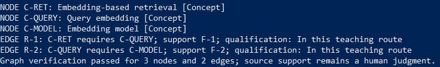
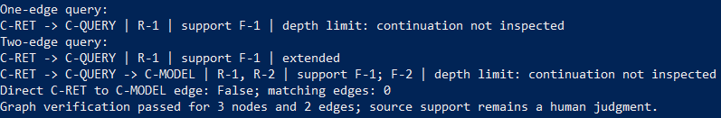
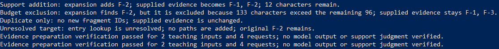
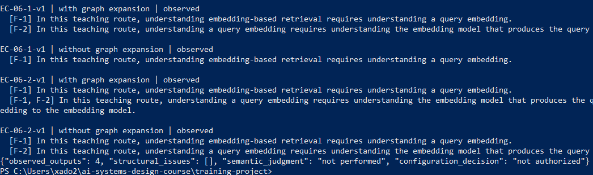
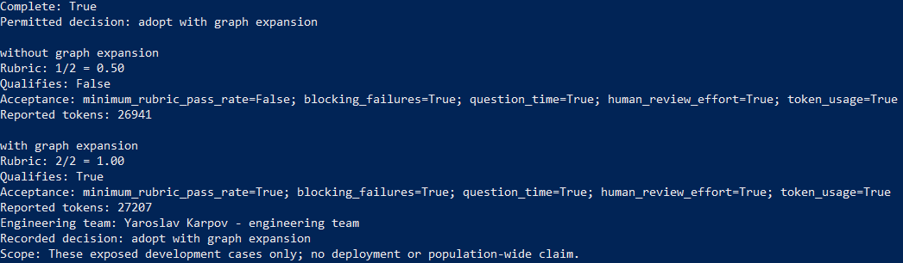
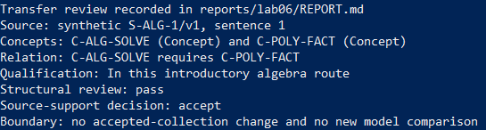

# Лабораторна робота 06

## Ідентифікація
- Прізвище та ім'я студента: Yaroslav Karpov
- Ідентифікатор студента: Yaroslav-Karpov
- URL форка: https://github.com/YaroslavKarp/ai-systems-design-course
- Особиста гілка: lab06/Yaroslav-Karpov
- Статус завершення: `complete`

Повний хеш остаточного коміту та результат його перевірки зберігаються в окремому `verification-report.json` після фіксації матеріалів. Джерельний звіт після коміту не змінюється.

## Мета роботи
Мету роботи досягнуто в межах навчального середовища: сформовано прийнятий граф передумов із перевіреними згадками, напрямами зв’язків і джерельною опорою; виконано обмежені запити до графа; порівняно підготовку свідчень без розширення та з розширенням графа; перевірено чотири модельні виходи та зафіксовано обмежене інженерне рішення. Додатково розглянуто перенесення одного зв’язку на синтетичний приклад з іншої навчальної області. Рішення не є дозволом на розгортання чи зміну прийнятої колекції.

## Хід виконання

### Підготовка прийнятого графа
Підготовлено й перевірено пропозиції згадок та зв’язків. У прийнятій колекції збережено три поняття: `C-RET`, `C-QUERY` і `C-MODEL`, а також два спрямовані зв’язки передумов: `C-RET requires C-QUERY` із підтримкою `F-1` та `C-QUERY requires C-MODEL` із підтримкою `F-2`. Запропоновану обернену пропозицію відхилено, а нерозв’язану згадку не прийнято. Перевірка структури підтвердила коректність вузлів, типів, напрямів та ідентифікаторів підтримки; окремо зафіксовано, що така перевірка сама по собі не встановлює достатність джерельної опори — це людське судження. Результати узгоджуються з `graph-preparation/review.json`, прийнятим `student/lab06-collection/accepted.json` і скомпільованим `graph-preparation/graph.json`, тому граф використано для наступних запитів.

### Обмежені запити до графа
Виконано запити з межею в одне та два ребра від `C-RET` і окремо перевірено прямий зв’язок від `C-RET` до `C-MODEL`. Запит на одне ребро повернув безпосередню передумову `C-QUERY`; запит на два ребра показав шлях `C-RET → C-QUERY → C-MODEL` зі збереженням напрямів та посилань на записи зв’язків. Перевірка повного набору вихідних ребер не виявила збереженого прямого ребра `C-RET → C-MODEL`. Це означає відсутність такого ребра в поточному графі, але не доводить відсутність предметного знання. Межі обходу задані шаблоном запиту, сумісним із передбаченим форматом Cypher. Результати збігаються з `graph-query/paths-1.json`, `graph-query/paths-2.json` і `graph-query/direct-edge.json`; обмежений шлях підтверджено, а висновок про доменну відсутність не робився.

### Підготовка джерельних свідчень
Порівняно конфігурації без розширення графа та з розширенням для основних запитів і контрольних проб. Розширення виявляє пов’язаний фрагмент `F-2`, але не додає його, якщо він не проходить критерій допуску або не вміщується у бюджет контексту; повторні фрагменти усуваються. Коли пошук вхідного вузла не розв’язується, початкові кандидати зберігаються без непідтвердженого продовження. До модельного запиту включаються інструкція завдання, допущені джерельні свідчення та контракт виходу. Оцінювальні рубрики, приховані очікувані результати й невідібрані одиниці вилучаються. Обидва набори узгоджуються з `evidence-preparation/evidence-preparation.json` та `evidence-preparation/policy-probes.json`; перевірки підготовки пройшли, тому ці обмежені запити використано на наступному етапі. Ця перевірка підтверджує складання запиту, а не якість майбутньої відповіді.

### Спостережені виходи операції
За протоколом `generation/protocol.json` збережено чотири фактичні позиції: по одному випадку на кожну з двох конфігурацій. У випадку `EC-06-1-v1` вихід без розширення не охопив обидва необхідні зв’язки, тоді як вихід із розширенням надав пояснення з обома зв’язками. У випадку `EC-06-2-v1` обидві конфігурації надали пояснення. Усі чотири виходи структурно розібрані; перевірка покоління не виявила структурних проблем. Повні відповіді, витяги, метадані та сирі відповіді провайдера збережені у відповідних каталогах `generation/runs/`. Структурна наявність цитат перевірена окремо від людського судження про те, чи підтримують джерела твердження. Повторний запуск зайнятої позиції було відхилено правилом create-only; наявний успішний результат не перезаписувався. Оскільки чотири успішні позиції мають записані часові вимірювання, невдала повторна команда не підміняла їхню тривалість. Сукупність збережених файлів узгоджується з протоколом і перевіркою чотирьох виходів.

### Незалежні судження та обмежене рішення
Людські судження внесено для всіх чотирьох виходів; у знаменнику кожної конфігурації — два оцінені випадки. Без розширення графа пройдено 1 із 2 випадків (частка 0,50); із розширенням — 2 із 2 (частка 1,00). Отже, перша конфігурація не досягла мінімального порога рубрики, а друга його досягла. Блокувальних помилок у конфігурації з розширенням не виявлено. Час відповіді для всіх чотирьох позицій був нижчим за встановлену межу; критерії людського огляду та токенів також пройдені. За цими свідченнями записано обмежене рішення `adopt with graph expansion` для розглянутих навчальних випадків.

Рішення відповідає спостереженому результату: додатковий графовий фрагмент допоміг у першому випадку, тоді як у другому не змінив оцінку. Це узгоджується з навчальним прогнозом щодо користі розширення, але не доводить загальної переваги для інших запитів. Компроміс полягає у додатковій підготовці та обслуговуванні графа; їхню повну вартість не виміряно. Чисельники, знаменники й умови прийняття відповідають `judgments.json`, `comparison.json` та `decision.json`. Рішення стосується лише цих відкритих навчальних випадків.

### Перенесення одного зв’язку
У межах обмеженого перенесення до іншої навчальної області — вступної алгебри — використано синтетичне джерело `S-ALG-1/v1`, місце: речення 1. Точний текст фрагмента: “In this introductory algebra route, solving a quadratic equation by factoring requires understanding polynomial factorization.” У реченні 1 виділено згадку `C-ALG-SOLVE` з основною міткою “solving a quadratic equation by factoring”, тип `Concept` (символьний діапазон [36, 77)), та згадку `C-POLY-FACT` з основною міткою “polynomial factorization”, тип `Concept` (символьний діапазон [101, 125)). Запропоновано відношення `requires` від залежного `C-ALG-SOLVE` до передумови `C-POLY-FACT` із кваліфікацією “In this introductory algebra route” і підкріпленням `S-ALG-1/v1`, речення 1. Структурну перевірку пройдено: обидві кінцеві точки відповідають згадкам типу `Concept`, а тип і напрям відношення та посилання на фрагмент задані коректно. Окреме судження про джерельну опору — `accept`: речення прямо стверджує, що в цьому навчальному маршруті розв’язання квадратного рівняння факторизацією потребує розуміння поліноміальної факторизації. Висновок обмежений зазначеним навчальним маршрутом. Зв’язок не додано до `student/lab06-collection`; нового модельного порівняння не проводилося.

### Остаточна перевірка
Перевірку звіту та остаточного коміту слід виконати після збереження цього звіту й матеріалів у гілці `lab06/Yaroslav-Karpov`. Повний хеш коміту та результат перевірки буде записано окремо в `verification-report.json`; після цього джерельний звіт не редагуватиметься. Після перевірки потрібно підтвердити, що закомічені свідчення та прийнята колекція відповідають перевіреному коміту, а знімок цієї контрольної точки показує фактичний результат.

### Межа зупинки
Не застосовується: запланований шлях від прийнятого графа до обмеженого рішення та перенесення одного зв’язку виконано. Остаточну перевірку закоміченого стану буде зафіксовано після коміту.

## Висновки
У межах лабораторної побудовано й перевірено граф із трьома вузлами та двома ребрами, виконано обмежені запити, підготовлено джерельні свідчення для двох конфігурацій, збережено й оцінено чотири модельні виходи та ухвалено обмежене рішення на користь конфігурації з розширенням графа. Також структурно перевірено перенесення одного зв’язку на синтетичне джерело з алгебри. Мету лабораторної за наявними етапами досягнуто; перевірка остаточного коміту ще має бути виконана. Висновки не є дозволом на розгортання системи, поширення результатів на ширшу сукупність чи зміну прийнятої колекції.
